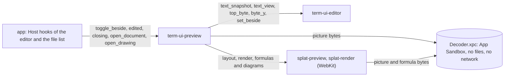

# term-ui-preview

Copied from Dango at commit `041f7ca1995c632beed490f033756e12642b65a3`: `src/preview/{markdown,page,sync,links,pdf,quick_look}.rs` and the self-test hooks of `src/preview` (E2, E22). `markdown/splat_app.rs` ("In Splat öffnen") already lives in term-ui-editor. A preview belongs to an editor of a workspace instead of a window: it shows beside the text inside the editor's own tab (`term_ui_editor::set_beside`) instead of in a companion pane, and follows the editor through its `EditorSerial`. Dango's Quick Look tab for pictures gave way to `image.rs`, which hands the file's bytes to Splat's sandboxed `Decoder.xpc`; the HTML preview in a browser tab and the automatic preview are cut. P7 brings later changes of either side over; until then this copy is the one that changes here.

A Markdown document's preview beside its editor: laid out off the main thread by `splat-preview`, set as native text by `splat-render`, with formulas and diagrams from its hidden WebKit page and pictures from files and, in a trusted workspace or on request, the web; it scrolls with the editor paragraph by paragraph. Pictures in a tab of their own decode in the service, PDF files show through PDFKit, sound, films, fonts and office documents through Quick Look, which reads them out of process.

The API is documented in [`src/lib.rs`](src/lib.rs).
