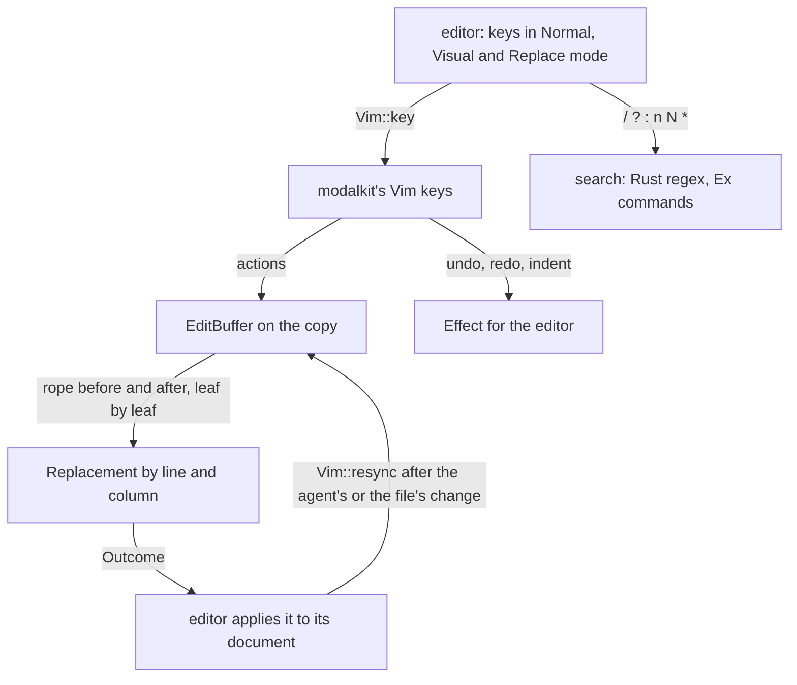

# term-vim

Copied from Dango at commit `01bba21a061a1ee15e24336c2bc9b3bd644b6d6c`: ide-vim (E2). P7 brings later changes of either side over; until then this copy is the one that changes here.

Vim's modes, keys, motions and operators for the editor (E104–E106), without AppKit and the only crate that knows `modalkit`. A `Vim` keeps a copy of an editor's text with LF line ends, lets `modalkit`'s Vim keys and `EditBuffer` carry out motions, operators, text objects, registers, marks, visual mode, `.` and macros on it, and hands back each change as one replacement by line and column in characters, which the editor applies to its own document. Undo, redo, saving, closing and indenting go to the editor as effects; `/`, `?`, `n`, `N`, `*` and `:s` search with Rust's regular expressions. `modalkit` comes as a copy under `vendor/` with `ropey` without its default `unicode_lines`, so that `ide-document` keeps its rule for line breaks (F1).

The API is documented in [`src/lib.rs`](src/lib.rs).
