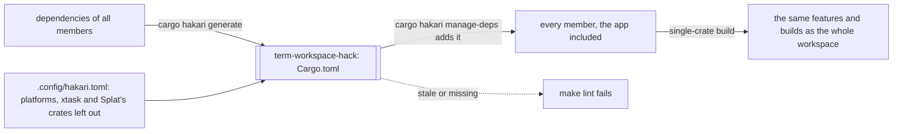

# term-workspace-hack

Taken over from Dango's `ide-workspace-hack` at commit `e9710234d51bf6aeb005cfacf41718adff8d6d38` (E24, Dango's E194). Cargo turns on the features of a dependency that the crates of one build need, so a single-crate run such as `cargo check -p term-render` built serde, regex and toml_edit, and every crate above them, again with features of its own. This crate depends on each such dependency with the features all members together use, and every member depends on it, so each dependency is built once per profile. It has no code.

How to keep it current is in [docs/development.md](../../docs/development.md#workspace-hack).
